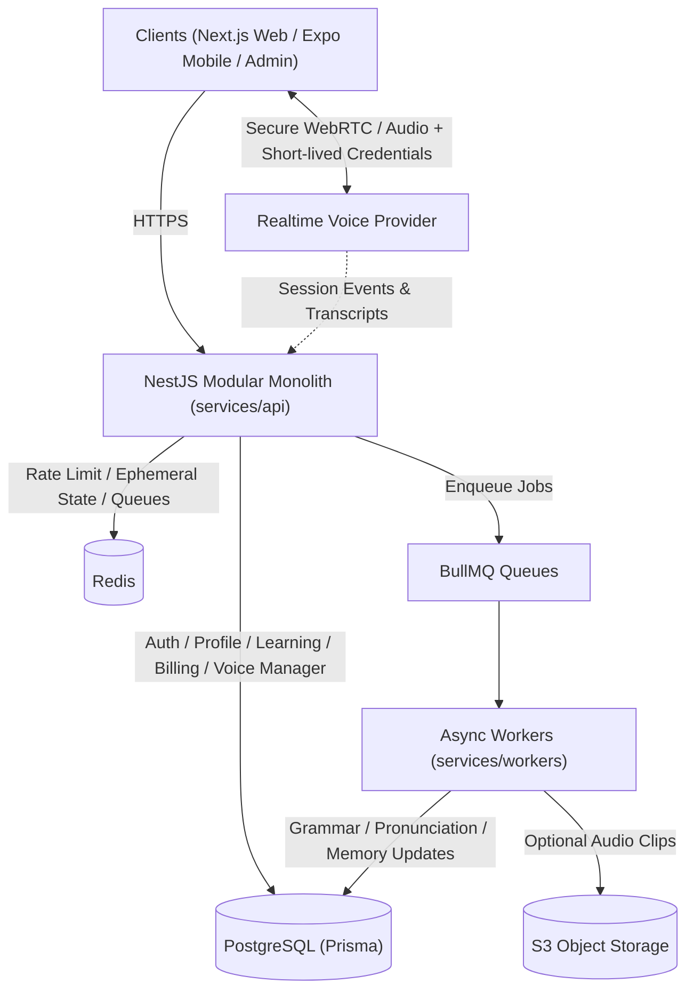
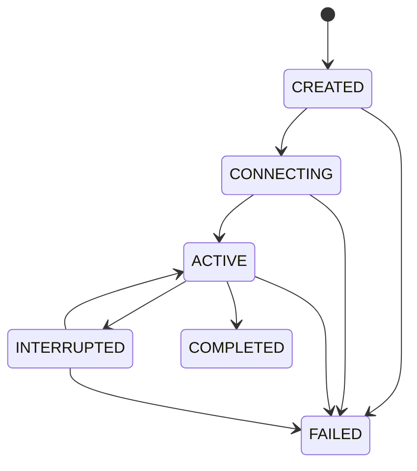

# Technical Architecture v1.0

## 1. Architecture Strategy

English Sathi follows a **Modular Monolith** architecture inside an **npm workspaces + Turborepo** TypeScript monorepo:

- **One main backend (`services/api`)**: NestJS modular monolith with clear domain boundaries (`auth`, `users`, `profiles`, `assessments`, `learning`, `lessons`, `voice`, `conversations`, `evaluations`, `vocabulary`, `progress`, `subscriptions`, `usage`, `notifications`, `admin`).
- **Independent voice session handling**: Manages short-lived provider credentials, voice session state transitions, audio events, and lifecycle limits without proxying every raw audio packet through the core REST server.
- **Asynchronous evaluation workers (`services/workers`)**: BullMQ workers handling grammar analysis, pronunciation evaluation, vocabulary tracking, learner memory updates, and retention cleanup.

### Why Modular Monolith First?
Avoiding premature microservices eliminates distributed debugging, service-to-service auth boilerplate, cross-service network failures, and unnecessary infrastructure cost for a solo developer. Any module with strict domain and DB boundaries can be extracted later if workload demands it.

---

## 2. Technology Stack

| Layer | Technology | Responsibility |
| :--- | :--- | :--- |
| **Web** | Next.js + TypeScript + Tailwind CSS | Learner web app & admin portal |
| **Mobile** | React Native + Expo | Android and iOS clients |
| **Backend** | NestJS + TypeScript | Business APIs, Auth, Session orchestration |
| **Validation** | Zod | Shared request, response & env validation |
| **Database** | PostgreSQL + Prisma ORM | Relational system of record |
| **Cache & Queue** | Redis + BullMQ | Ephemeral session state, rate limiting, background jobs |
| **Real-time Voice** | WebRTC / WebSocket | Low-latency voice interaction |
| **AI & Evaluation** | Realtime Speech + Gemini / STT + Speech Analysis | Live conversation & async learning evaluation |
| **Storage** | S3-compatible object storage | Optional, consent-based audio recordings |
| **Observability** | OpenTelemetry + Sentry | Tracing, errors, and structured logs |
| **Deployment** | Docker + Cloud infrastructure | Containerized local & cloud runtime |

---

## 3. High-Level System Architecture



---

## 4. Hybrid Voice Architecture (Dual Pipeline)

1. **Path A — Real-Time Conversation (Hot Path)**:
   - Client requests a speaking session (`POST /api/v1/voice/sessions`).
   - Backend checks auth and server-side quota, creates `VoiceSession`, and returns restricted short-lived credentials.
   - User microphone streams directly to the real-time voice provider for speech understanding, interruption support, and spoken tutor replies.
2. **Path B — Asynchronous Evaluation (Cold Path)**:
   - Completed turns/sessions trigger BullMQ evaluation jobs (`evaluation`, `transcription`, `pronunciation`, `learning`, `planning`, `retention`, `analytics`).
   - Separates live conversational encouragement from detailed grammar correction, pronunciation confidence checks, and learner memory extraction.

### Voice Session Lifecycle State Machine



**Lifecycle Rules:**
- Users cannot exceed server-side entitlements.
- Session ownership is verified on every request.
- Session completion and billing usage updates are idempotent and transactional.
- Failed provider connections never silently consume full quota allowances.

---

## 5. Monorepo Structure

```text
English_Sathi/
├── apps/
│   ├── web/                  # Next.js learner web client
│   ├── admin/                # Next.js admin & curriculum dashboard
│   └── mobile/               # React Native + Expo mobile app
├── services/
│   ├── api/                  # NestJS modular monolith backend
│   │   └── src/
│   │       ├── config/       # Env validation & app configs
│   │       ├── common/       # Filters, pipes, interceptors, guards
│   │       ├── infrastructure/ # Prisma, Redis, Queue, AI adapters
│   │       └── modules/      # Business domain modules
│   └── workers/              # BullMQ async workers
├── packages/
│   ├── database/             # Prisma schema, migrations, client
│   ├── shared-types/         # Canonical TypeScript types & DTOs
│   ├── validation/           # Shared Zod validation schemas
│   └── ai/                   # Pedagogical AI tutor engine & provider abstraction
├── infrastructure/
│   └── docker/               # Local PostgreSQL + Redis setup
├── docs/
│   ├── PRD.md                # Product Requirements Document v1.0
│   ├── architecture.md       # Technical Architecture v1.0
│   └── decisions/            # Architecture Decision Records (ADRs)
└── .github/workflows/        # Automated CI verification
```

*(Additional shared packages such as `contracts`, `learning-engine`, `design-system`, and `observability` will be introduced incrementally in the milestones that require them).*

---

## 6. Database & Data Ownership Rules

- **PostgreSQL (System of Record)**: `users`, `user_profiles`, `assessments`, `assessment_results`, `lessons`, `learning_paths`, `lesson_progress`, `voice_sessions`, `messages`, `session_evaluations`, `learning_events`, `vocabulary_items`, `learning_memories`, `plans`, `subscriptions`, `usage_records`.
- **Redis**: Ephemeral session locks, active timers, rate limits, cache, BullMQ queues (never the permanent source of truth).
- **Object Storage**: Optional, consent-based audio recordings governed by configurable retention TTLs.
- **Security**: Never persist reusable provider secrets or payment card details. Enforce `LessonProgress -> User` and `UserProfile -> User` foreign key cascades and non-negative usage constraints.
